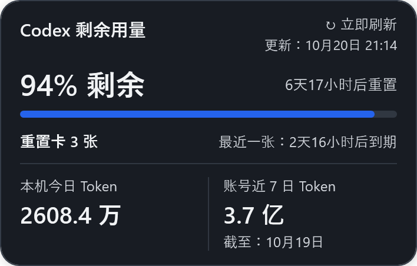

# Codex 剩余用量

面向 Windows 10 22H2 和 Windows 11 x64 的 Codex 用量悬浮胶囊。

## 下载

- [下载 v0.3.0 安装包](https://github.com/VentureDuan/codex-remaining/releases/download/v0.3.0/CodexRemaining-Setup.exe)
- [全部版本](https://github.com/VentureDuan/codex-remaining/releases) · [更新日志](./CHANGELOG.md)

安装包为 x64 自包含程序，无需另装 .NET。使用前请先安装并登录 Codex。

## 产品展示

### 收起状态


小巧的悬浮胶囊常驻桌面，只显示一周额度余额，例如 `周 95%`。

### 展开状态



展开后可查看剩余额度进度条、距重置的倒计时、重置卡数量及最近到期时间，以及 Token 统计。点击右上角「立即刷新」更新数据。

界面自动跟随 Windows 浅色或深色主题，可查看[浅色主题预览](./docs/images/product-preview-light.png)。以上界面使用示例数据；实际数值取自当前登录账号。

### 状态配色

胶囊状态点、收起时的描边和展开后的进度条使用相同的状态配色。进度条填充部分表示**剩余额度**。

| 颜色 | 含义 |
| --- | --- |
| 蓝色 | 正常：剩余额度大于 20% |
| 橙色 | 警告：剩余额度为 10%–20%（含边界） |
| 红色 | 危险：剩余额度小于 10% |
| 灰色 | 数据已过期或暂时无法获取；加载中使用深灰色 |

重置卡和 Token 统计分别标记读取状态；某项失败时保留该项上次成功数据并注明“数据已过期”，未知数据不会显示为 0。

## 使用

安装前请先安装并登录 Codex。运行 `CodexRemaining-Setup.exe` 后，悬浮胶囊会显示当前一周订阅额度的剩余百分比；展开后显示重置倒计时、重置卡数量与到期详情、账号近 7 日 Token 和本机今日 Token，并默认随 Windows 启动。

- 左键点击：展开或收起剩余额度进度、重置倒计时、重置卡详情、Token 统计和更新时间
- 左键拖动：移动悬浮胶囊；靠近显示器边缘或角落时自动附着
- 右键菜单：立即刷新、选择 1/5/10 分钟自动刷新间隔、切换开机自启、选择小/中/大胶囊尺寸、重置位置或退出
- 位置恢复：保留尺寸和附着位置；显示器拔插或分辨率变化后自动迁移到可见工作区
- 自动刷新：默认每 5 分钟一次；各项失败时分别保留上次成功数据并标记为过期

## 构建

需要 .NET 10 SDK 和 Inno Setup 6。执行：

```powershell
.\scripts\package.ps1
```

安装包输出到 `artifacts\CodexRemaining-Setup.exe`。

## 设计文档

- [产品规格](./docs/product-spec.md)
- [架构](./docs/architecture.md)
- [实施计划](./docs/implementation-plan.md)
- [领域词汇](./CONTEXT.md)
- [架构决策](./docs/adr/)
