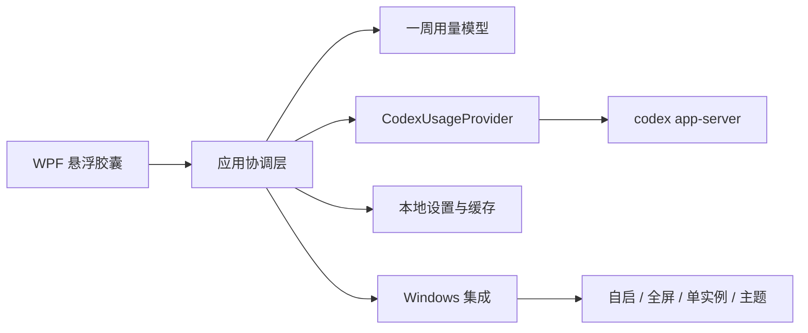

# Codex 剩余用量架构

## 总体结构

## 模块边界

### Presentation

WPF 只负责悬浮胶囊的展示与交互。它消费应用状态，不解析 Codex 协议，也不直接读写注册表或本地文件。

### Application

协调启动刷新、5 分钟周期刷新、手动刷新和重复启动刷新。任一时刻只允许一个刷新操作，刷新结果转换为 `Fresh`、`Stale` 或 `Unavailable` 状态。

### Domain

领域模型只表达一周用量窗口：

- `remainingPercent = 100 - usedPercent`
- 通过 `windowDurationMins == 10080` 识别一周窗口
- 正常：`remainingPercent > 20`
- 警告：`10 <= remainingPercent <= 20`
- 危险：`remainingPercent < 10`

外部数据缺失、越界或无法识别一周窗口时不得伪造百分比。

### Codex integration

`CodexUsageProvider` 发现本机 `codex.exe`，以子进程方式启动 `codex app-server`，初始化协议后调用 `account/rateLimits/read`。它只向上层返回必要字段，不暴露认证数据或完整响应；应用退出时只终止自己创建的子进程。

当前集成依赖实验性的 app-server 协议。找不到方法、响应结构不兼容或无法识别一周窗口时，统一返回可诊断的不兼容错误，由界面显示过期状态或“暂时无法获取”。

### Windows integration

- 使用命名互斥量保证单实例，并用本机进程间信号唤醒已有实例。
- 使用当前用户的 `HKCU` 自启项，不申请管理员权限。
- 监听系统浅色/深色主题变化。
- 检测前台窗口是否覆盖其显示器工作区，以决定全屏自动隐藏与恢复。
- 保存窗口所在显示器及位置；恢复时将坐标约束在当前可见屏幕内。

## 状态模型

- `Loading`：首次读取尚未完成。
- `Fresh`：最近一次读取成功，展示当前剩余百分比和重置时间。
- `Stale`：读取失败但存在最后成功数据；展示该数据、过期标记、最后成功时间和重试操作。
- `Unavailable`：从未成功读取；展示“暂时无法获取”和具体可操作原因。

缓存、设置和日志位于 `%LOCALAPPDATA%\CodexRemaining`。缓存不包含凭据、邮箱或完整 app-server 响应。

## 打包

应用使用 C#、.NET 10 和 WPF，发布为 `win-x64` 自包含程序。使用面向当前用户的安装脚本生成 `CodexRemaining-Setup.exe`，安装到 `%LOCALAPPDATA%\Programs\CodexRemaining` 并注册标准卸载入口；MVP 不签名、不自动更新。
