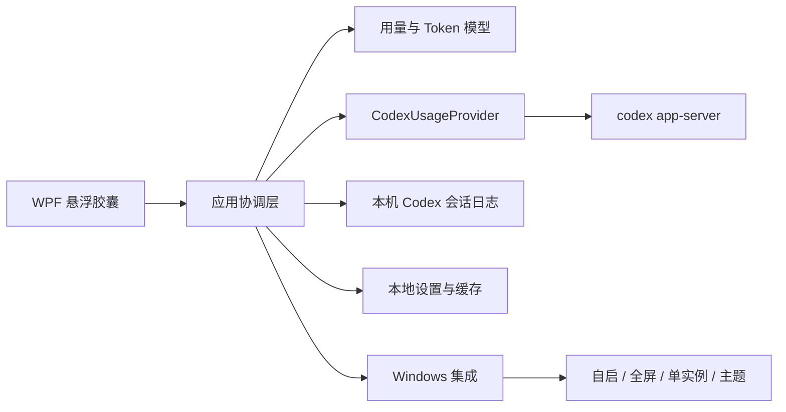

# Codex 剩余用量架构

## 总体结构

## 模块边界

### Presentation

WPF 只负责悬浮胶囊的展示与交互。进度条绑定剩余比例；界面每 30 秒根据当前时间重算重置和卡片到期倒计时，不增加网络请求。它消费应用状态，不解析 Codex 协议，也不直接读写注册表或本地文件。

### Application

协调启动刷新、可配置周期刷新、手动刷新和重复启动刷新。自动刷新支持 1、5、10 分钟，默认 5 分钟；任一时刻只允许一个刷新操作。一周窗口、重置卡、账号近 7 日 Token 和本机今日 Token 分别转换为 `Fresh`、`Stale` 或 `Unavailable` 状态。

### Domain

领域模型表达额度、重置卡和 Token 用量：

- `remainingPercent = 100 - usedPercent`
- 通过 `windowDurationMins == 10080` 识别一周窗口
- 账号近 7 日 Token 以账号侧最新可用日期为截止日，汇总连续 7 个自然日
- 本机今日 Token 以本机时区自然日为边界，汇总本机 Codex 会话中 Token 事件的真实增量
- 重置卡数量以 `availableCount` 为准；到期明细可缺失或被截断，保留是否完整的标记，不用明细条数替代可用数量
- 正常：`remainingPercent > 20`
- 警告：`10 <= remainingPercent <= 20`
- 危险：`remainingPercent < 10`

外部数据缺失、越界或无法识别一周窗口时不得伪造百分比。

### Codex integration

`CodexUsageProvider` 发现本机 `codex.exe`，以子进程方式启动 `codex app-server`，初始化协议后分别调用 `account/rateLimits/read` 和 `account/usage/read`。前者提供一周窗口和 `rateLimitResetCredits`，两者独立解析、缓存并标记失败，缺少重置卡字段不影响周额度。多桶响应优先选择 `rateLimitsByLimitId.codex`，否则回退 `rateLimits`。后者提供账号每日 Token bucket；账号近 7 日按最新 bucket 日期汇总并显式保留截止日期。它只向上层返回必要字段，不暴露认证数据或完整响应；应用退出时只终止自己创建的子进程。

本机 Token 读取器只读扫描当前 Codex 配置目录下的 `sessions` 与 `archived_sessions` JSONL 文件，解析 `event_msg.token_count` 的累计 Token 并计算增量。它按事件时间转换到本机时区，只汇总当天数据；损坏或无关日志行被忽略，不读取对话正文。

当前集成依赖实验性的 app-server 协议。找不到方法、响应结构不兼容或无法识别数据时，为对应数据项返回可诊断的不兼容错误；其他数据项仍可成功刷新。

### Windows integration

- 使用命名互斥量保证单实例，并用本机进程间信号唤醒已有实例。
- 使用当前用户的 `HKCU` 自启项，不申请管理员权限。
- 监听系统浅色/深色主题变化。
- 检测前台窗口是否覆盖其显示器工作区，以决定全屏自动隐藏与恢复。
- 以物理像素计算当前显示器工作区和 DPI 对应的吸附距离，将拖动结果归类为未附着、边缘附着或角落附着。
- 保存胶囊尺寸，以及附着显示器、边缘或角落和归一化沿边位置；尺寸或分辨率变化后据此向屏幕内部恢复。
- 附着显示器缺失时，根据原显示器中心选择距离最近的可用显示器；未附着位置恢复时将坐标约束在当前可见屏幕内。

## 状态模型

- `Loading`：该数据项首次读取尚未完成。
- `Fresh`：该数据项最近一次读取成功。
- `Stale`：该数据项读取失败但存在最后成功数据；展示该数据、过期标记和最后成功时间。
- `Unavailable`：该数据项从未成功读取；展示“暂时无法获取”。只有全部数据项都不可用时，面板才整体不可用。

缓存、设置和日志位于 `%LOCALAPPDATA%\CodexRemaining`。缓存不包含凭据、邮箱或完整 app-server 响应。

## 打包

应用使用 C#、.NET 10 和 WPF，发布为 `win-x64` 自包含程序。使用面向当前用户的安装脚本生成 `CodexRemaining-Setup.exe`，安装到 `%LOCALAPPDATA%\Programs\CodexRemaining` 并注册标准卸载入口；MVP 不签名、不自动更新。

## 协议参考

- [官方 App Server 额度与重置卡字段](https://learn.chatgpt.com/docs/app-server#6-rate-limits-chatgpt)
